# 大健康养老公寓管理系统to14d

> 🎓 **计算机毕业设计 · 大健康养老公寓管理系统to14d**
>
> 本仓库只放**项目介绍 + 运行截图**（截图是站点带水印的原图，存在仓库 `images/` 里）。
>
> 👉 **完整可运行源码 / 数据库脚本 / 部署文档：[点我获取](https://geekcode.top/archives/%E5%A4%A7%E5%81%A5%E5%BA%B7%E5%85%BB%E8%80%81%E5%85%AC%E5%AF%93%E7%AE%A1%E7%90%86%E7%B3%BB%E7%BB%9Fto14d?utm_source=github)**
>
> 💬 咨询微信：**ir9372**　|　🌐 更多项目：[极客代码 geekcode.top](https://geekcode.top/?utm_source=github)
>
> 📌 项目详情页：<https://geekcode.top/archives/%E5%A4%A7%E5%81%A5%E5%BA%B7%E5%85%BB%E8%80%81%E5%85%AC%E5%AF%93%E7%AE%A1%E7%90%86%E7%B3%BB%E7%BB%9Fto14d?utm_source=github>

<table><td width="230" align="center"> <b>扫码加微信 ir9372</b></td><td valign="middle">📦 源码 = 项目介绍 + 全部运行截图 + 数据库 + 部署文档 👉 点上方任意截图，直接跳到 <b>极客代码 geekcode.top</b> 详情页</td></table>

---

<h1>大健康养老公寓管理系统_to14d</h1>
<h2>项目概述</h2>

大健康养老公寓管理系统旨在为现代化养老机构提供数字化管理解决方案，解决传统纸质化管理效率低、信息孤岛严重及数据追溯困难等痛点。系统核心功能涵盖入住办理、房间资源管理、护理服务记录、费用标准配置、请假与退住流程审批以及护工人员管理等全流程业务场景。适用人群主要为养老院行政管理人员、护理主管及系统维护人员。技术架构采用前后端分离模式，后端基于 Spring Boot 框架结合 MyBatis-Plus 实现高效的数据持久层操作，利用 Shiro 进行安全权限控制，前端通过 Vue 构建后台管理界面，确保系统具备高可用性、易扩展性及良好的交互体验。

<h2>技术架构</h2>

本项目采用经典的 B/S 架构，具体技术选型如下：

<ol>
<li><strong>后端架构</strong>：</li>
</ol>
<ul>
<li><strong>核心框架</strong>：使用 <code>spring-boot-starter-web</code> 构建 RESTful API 服务，简化 HTTP 请求处理与响应。</li>
<li><strong>数据持久层</strong>：集成 <code>mybatis-spring-boot-starter</code> 和 <code>mybatis-plus</code>，利用 MyBatis-Plus 提供的通用 CRUD 接口大幅减少样板代码，提高开发效率；底层数据库连接池依赖 <code>spring-boot-starter-jdbc</code>。</li>
<li><strong>数据库驱动</strong>：使用 <code>mysql-connector-java</code> 连接 MySQL 数据库。</li>
<li><strong>安全模块</strong>：引入 <code>shiro-spring</code> 实现身份认证与授权管理，保障系统访问安全性。</li>
<li><strong>辅助组件</strong>：<code>commons-lang3</code> 用于常用工具类支持，<code>validation-api</code> 用于参数校验，<code>protobuf-java</code> 可能用于特定数据序列化或通信协议支持。</li>
</ul>
<ol start="2">
<li><strong>前端架构</strong>：</li>
</ol>
<ul>
<li>项目类型为 <code>vue-integrated</code>，表明前端采用 Vue.js 框架构建单页面应用（SPA），并通过路由映射后台管理功能模块。由于无前台用户端，前端仅包含后台管理系统界面。</li>
</ul>
<ol start="3">
<li><strong>数据库设计要点</strong>：</li>
</ol>
<ul>
<li>数据库围绕“人、房、事、费”四大核心实体进行建模。主要表结构包括用户表、护工表、房间类型表、房间信息表、入住信息表、退住信息表、护理信息表、接待信息表、请假信息表、续住信息表、收费标准表及公告信息表。各表之间通过外键关联，形成完整的业务闭环。</li>
</ul>
<ol start="4">
<li><strong>架构图示</strong>：</li>
</ol>

<a href="https://geekcode.top/archives/%E5%A4%A7%E5%81%A5%E5%BA%B7%E5%85%BB%E8%80%81%E5%85%AC%E5%AF%93%E7%AE%A1%E7%90%86%E7%B3%BB%E7%BB%9Fto14d?utm_source=github" title="查看完整源码">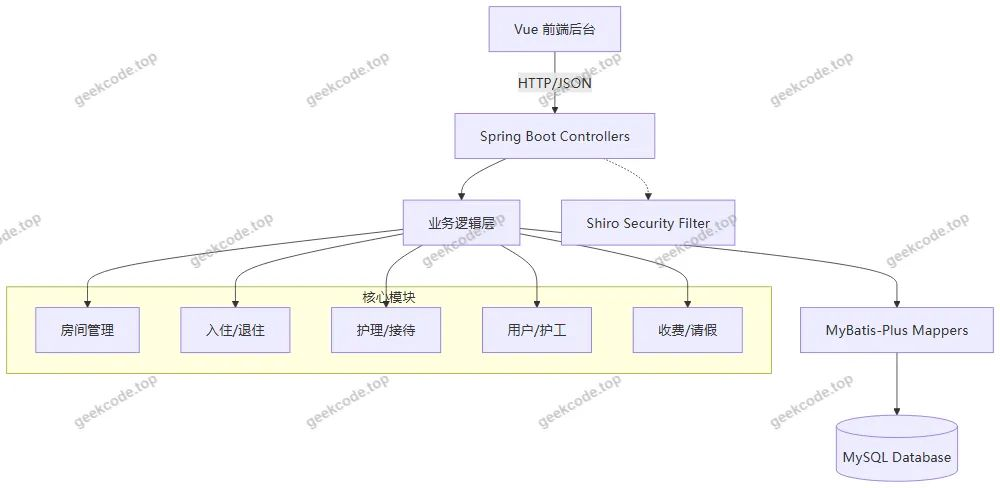</a>

<h2>功能模块</h2>

根据后台路由 <code>/news</code>, <code>/tuizhuxinxi</code>, <code>/tixingxinxi</code>, <code>/fangjianxinxi</code>, <code>/fangjianleixing</code>, <code>/ruzhuxinxi</code>, <code>/jiedaixinxi</code>, <code>/hulixinxi</code>, <code>/yonghu</code>, <code>/qingjiaxinxi</code>, <code>/hugong</code>, <code>/shoufeibiaozhun</code>, <code>/xuzhuxinxi</code> 及控制器列表，系统主要功能模块如下：

<h3>1. 基础信息管理模块</h3>
<ul>
<li><strong>用户管理 (<code>/yonghu</code>)</strong>：负责系统登录用户的账号创建、修改、删除及状态管理，对应 <code>CommonController</code> 或专用用户接口。</li>
<li><strong>护工管理 (<code>/hugong</code>)</strong>：管理养老公寓护理人员的基本档案，包括姓名、联系方式、资质等信息，由 <code>HugongController</code> 处理。</li>
<li><strong>公告信息 (<code>/news</code>)</strong>：发布和管理面向内部人员的通知公告，如政策调整、活动通知等，由 <code>NewsController</code> 处理。</li>
</ul>
<h3>2. 房产资源管理模块</h3>
<ul>
<li><strong>房间类型 (<code>/fangjianleixing</code>)</strong>：定义房间的类别（如单人间、双人间、套房等）及其基础属性，由 <code>FangjianleixingController</code> 处理。</li>
<li><strong>房间信息 (<code>/fangjianxinxi</code>)</strong>：管理具体房间的状态（空闲、占用、维修）、位置及所属类型，由 <code>FangjianxinxiController</code> 处理。</li>
</ul>
<h3>3. 入住业务流程模块</h3>
<ul>
<li><strong>接待信息 (<code>/jiedaixinxi</code>)</strong>：记录潜在入住者或家属的咨询接待情况，跟踪意向客户，由 <code>JiedaixinxiController</code> 处理。</li>
<li><strong>入住信息 (<code>/ruzhuxinxi</code>)</strong>：正式办理老人入住手续，记录入住时间、床位分配、合同信息等，由 <code>RuzhuxinxiController</code> 处理。</li>
<li><strong>退住信息 (<code>/tuizhuxinxi</code>)</strong>：处理老人离院申请，记录退住原因、结算时间及物品归还情况，由 <code>TuizhuxinxiController</code> 处理。</li>
<li><strong>续住信息 (<code>/xuzhuxinxi</code>)</strong>：针对长期居住老人的定期续签或延期管理，确保住宿状态的连续性。</li>
</ul>
<h3>4. 护理与服务管理模块</h3>
<ul>
<li><strong>护理信息 (<code>/hulixinxi</code>)</strong>：记录每日或定期的护理执行情况，包括生命体征监测、用药提醒、生活照料细节，由 <code>HulixinxiController</code> 处理。</li>
<li><strong>提醒信息 (<code>/tixingxinxi</code>)</strong>：系统生成的各类待办事项提醒，如生日提醒、服药提醒、检查预约等。</li>
</ul>
<h3>5. 财务与考勤管理模块</h3>
<ul>
<li><strong>收费标准 (<code>/shoufeibiaozhun</code>)</strong>：配置不同房间类型或服务项目的价格体系，支持费用的标准化计算，由 <code>ShoufeibiaozhunController</code> 处理。</li>
<li><strong>请假信息 (<code>/qingjiaxinxi</code>)</strong>：管理老人短期外出探亲或就医的请假申请与审批流程，由 <code>QingjiaxinxiController</code> 处理。</li>
</ul>
<h3>6. 系统配置模块</h3>
<ul>
<li><strong>文件上传与管理</strong>：通过 <code>FileController</code> 支持头像、证件照、合同扫描件等文件的上传与下载。</li>
<li><strong>系统配置</strong>：通过 <code>ConfigController</code> 管理系统的字典项、开关配置等全局参数。</li>
</ul>
<h2>用户角色与权限</h2>

根据现有源码上下文，系统主要涉及以下角色及其权限范围：

<ol>
<li><strong>管理员 (Admin)</strong></li>
</ol>
<ul>
<li><strong>身份认证</strong>：拥有唯一的超级管理员账户，通过后台登录页进入系统。</li>
<li><strong>全量数据访问</strong>：可访问所有功能模块，包括增删改查（CRUD）操作。</li>
<li><strong>具体权限</strong>：</li>
<li><strong>用户管理</strong>：创建、编辑、禁用普通用户或护工账号。</li>
<li><strong>资源配置</strong>：定义房间类型、录入房间信息、设定收费标准。</li>
<li><strong>业务审批</strong>：审核入住申请、退住结算、请假批准、续住确认。</li>
<li><strong>内容发布</strong>：发布公告、查看护理记录、监控提醒信息。</li>
<li><strong>系统维护</strong>：配置文件管理、查看日志（如有）。</li>
</ul>
<ol start="2">
<li><strong>普通用户/护工 (User/Hugong)</strong></li>
</ol>
<ul>
<li><strong>受限访问</strong>：虽然存在 <code>/yonghu</code> 和 <code>/hugong</code> 路由，但在典型的单体后台系统中，若未明确区分多租户或细粒度RBAC（基于角色的访问控制）的前端展示差异，通常这些角色在登录后可能仅能查看与自己相关的部分数据（如自己的排班、负责的住户护理记录）。</li>
<li><strong>注意</strong>：根据截图显示“后台-用户(admin)”、“后台-护工(admin)”，暗示当前演示环境主要以 Admin 视角为主。若系统实现了 Shiro 的角色隔离，普通用户登录后的菜单将动态隐藏其无权访问的管理模块（如无法修改收费标准或删除房间）。</li>
</ul>

<strong>权限矩阵示意：</strong>

<table>
<thead>
<tr>
<th align="left">功能模块</th>
<th align="center">管理员 (Admin)</th>
<th align="center">普通用户/护工 (推测)</th>
</tr>
</thead>
<tbody><tr>
<td align="left">登录后台</td>
<td align="center">✅</td>
<td align="center">✅</td>
</tr>
<tr>
<td align="left">用户管理</td>
<td align="center">✅</td>
<td align="center">❌</td>
</tr>
<tr>
<td align="left">护工档案管理</td>
<td align="center">✅</td>
<td align="center">👁️ (仅查看自身)</td>
</tr>
<tr>
<td align="left">房间/类型管理</td>
<td align="center">✅</td>
<td align="center">❌</td>
</tr>
<tr>
<td align="left">入住/退住/续住</td>
<td align="center">✅</td>
<td align="center">❌</td>
</tr>
<tr>
<td align="left">护理记录录入</td>
<td align="center">✅</td>
<td align="center">✍️ (仅限负责对象)</td>
</tr>
<tr>
<td align="left">收费标准配置</td>
<td align="center">✅</td>
<td align="center">❌</td>
</tr>
<tr>
<td align="left">请假审批</td>
<td align="center">✅</td>
<td align="center">📝 (仅发起/查看)</td>
</tr>
<tr>
<td align="left">公告发布</td>
<td align="center">✅</td>
<td align="center">👁️ (仅查看)</td>
</tr>
</tbody></table>

<em>(注：👁️表示只读，✍️表示写入，❌表示不可见)</em>

<h2>项目特色与创新点</h2>
<ol>
<li><strong>全流程闭环管理</strong>：系统覆盖了从“接待咨询”到“正式入住”，再到“日常护理”、“请假/续住”，直至“最终退住”的完整生命周期，消除了传统管理中各环节割裂的问题。</li>
<li><strong>精细化护理追踪</strong>：通过独立的 <code>护理信息</code> 和 <code>提醒信息</code> 模块，将抽象的服务过程转化为可视化的数据记录，有助于提升养老服务的质量和可追溯性。</li>
<li><strong>灵活的资源配置</strong>：将 <code>房间类型</code> 与 <code>收费标准</code> 解耦并独立管理，使得机构可以根据市场变化快速调整房型结构和价格策略，无需硬编码修改系统逻辑。</li>
<li><strong>安全稳定的技术底座</strong>：采用 Shiro 进行权限控制，相比简单的 Session 验证更安全；MyBatis-Plus 的使用提升了 SQL 执行效率和代码整洁度，降低了后期维护成本。</li>
<li><strong>专注后台效能</strong>：项目定位为纯后台管理系统，去除了冗余的前台门户开发，集中资源优化管理者的操作体验和数据录入效率，符合内部信息化建设的务实需求。</li>
</ol>
<h2>部署环境</h2>

为确保系统正常运行，需准备以下软件环境：

<ol>
<li><strong>操作系统</strong>：Windows Server, Linux (CentOS/Ubuntu), 或 macOS。</li>
<li><strong>Java 运行环境</strong>：JDK 1.8 或更高版本（推荐 JDK 1.8，兼容 Spring Boot 2.x）。</li>
<li><strong>数据库</strong>：MySQL 5.7 或 MySQL 8.0。需提前初始化数据库并导入项目提供的 SQL 脚本以建立表结构。</li>
<li><strong>Web 服务器</strong>：内置 Tomcat（由 <code>spring-boot-starter-web</code> 提供），无需额外安装外部 Web 容器。</li>
<li><strong>前端构建环境</strong>：Node.js (建议 v14+ 或 v16+) 和 npm/yarn，用于编译 Vue 前端代码生成静态资源。</li>
<li><strong>浏览器</strong>：Chrome, Edge, Firefox 等现代浏览器，用于访问后台管理界面。</li>
<li><strong>其他依赖</strong>：Maven 3.6+ 用于后端项目依赖管理和打包构建。</li>
</ol>
<h2>五、技术特性</h2>
<ul>
<li>前后端集成部署，前端资源打包至后端 static 目录</li>
<li>使用 MyBatis-Plus 简化数据访问层开发</li>
<li>集成 Shiro 权限框架实现角色权限控制</li>
</ul>
<h2>六、功能模块截图</h2>
<h3>后台管理端</h3>
<h4>后台-房间类型</h4>

<a href="https://geekcode.top/archives/%E5%A4%A7%E5%81%A5%E5%BA%B7%E5%85%BB%E8%80%81%E5%85%AC%E5%AF%93%E7%AE%A1%E7%90%86%E7%B3%BB%E7%BB%9Fto14d?utm_source=github" title="查看完整源码">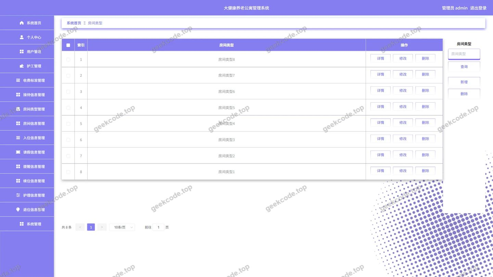</a>

<h4>后台-房间信息</h4>

<a href="https://geekcode.top/archives/%E5%A4%A7%E5%81%A5%E5%BA%B7%E5%85%BB%E8%80%81%E5%85%AC%E5%AF%93%E7%AE%A1%E7%90%86%E7%B3%BB%E7%BB%9Fto14d?utm_source=github" title="查看完整源码">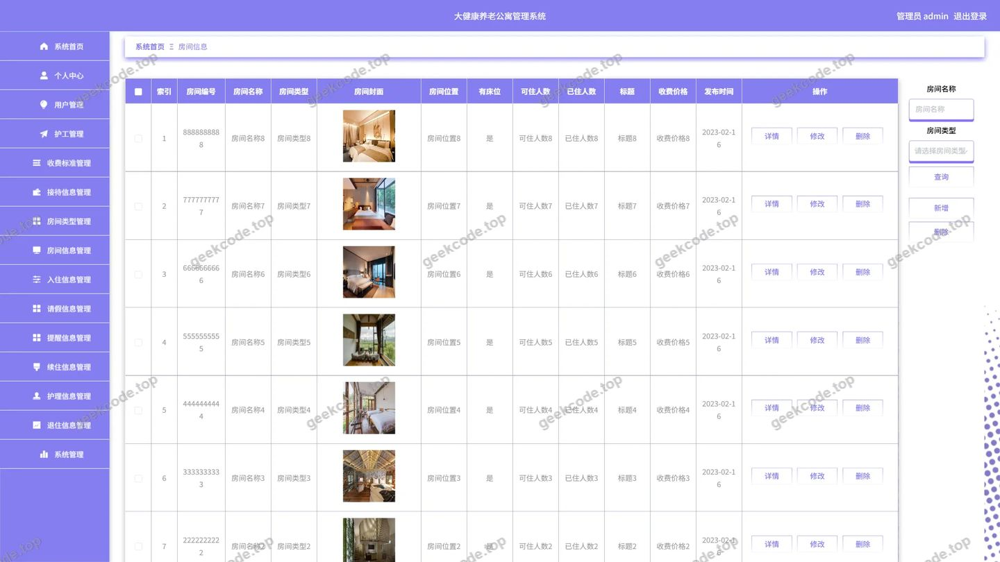</a>

<h4>后台首页</h4>

<a href="https://geekcode.top/archives/%E5%A4%A7%E5%81%A5%E5%BA%B7%E5%85%BB%E8%80%81%E5%85%AC%E5%AF%93%E7%AE%A1%E7%90%86%E7%B3%BB%E7%BB%9Fto14d?utm_source=github" title="查看完整源码">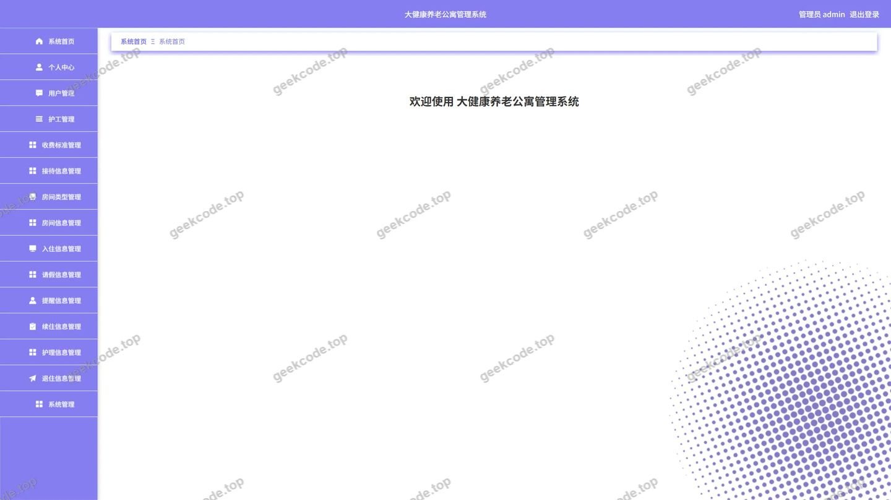</a>

<h4>后台-护工</h4>

<a href="https://geekcode.top/archives/%E5%A4%A7%E5%81%A5%E5%BA%B7%E5%85%BB%E8%80%81%E5%85%AC%E5%AF%93%E7%AE%A1%E7%90%86%E7%B3%BB%E7%BB%9Fto14d?utm_source=github" title="查看完整源码">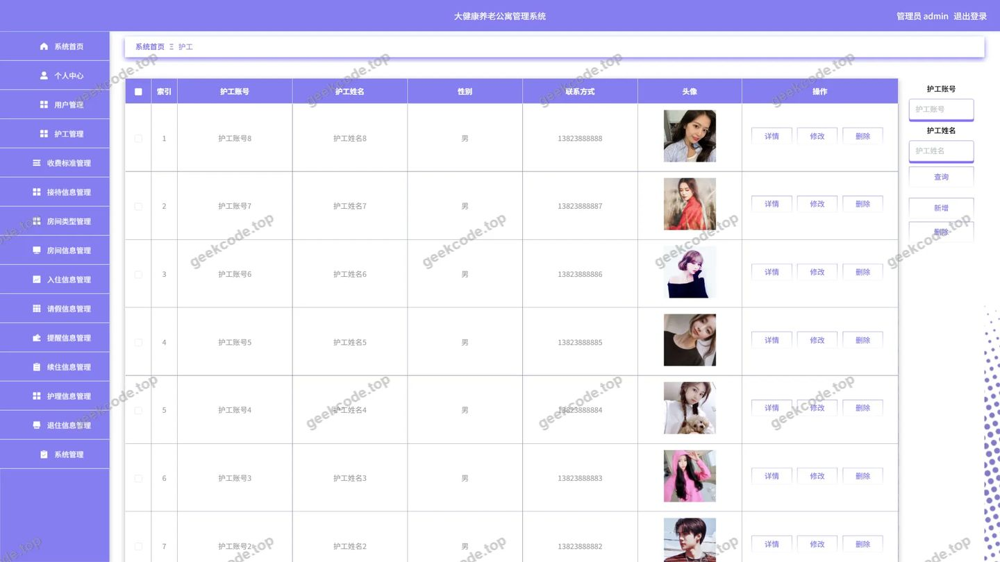</a>

<h4>后台-护理信息</h4>

<a href="https://geekcode.top/archives/%E5%A4%A7%E5%81%A5%E5%BA%B7%E5%85%BB%E8%80%81%E5%85%AC%E5%AF%93%E7%AE%A1%E7%90%86%E7%B3%BB%E7%BB%9Fto14d?utm_source=github" title="查看完整源码">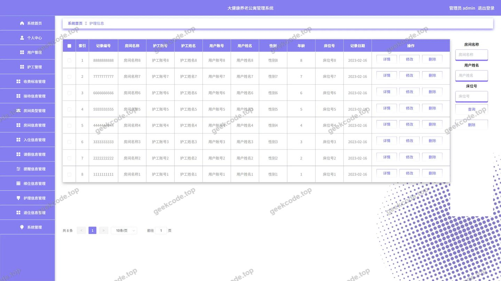</a>

<h4>后台-接待信息</h4>

<h4>后台-登录</h4>

<a href="https://geekcode.top/archives/%E5%A4%A7%E5%81%A5%E5%BA%B7%E5%85%BB%E8%80%81%E5%85%AC%E5%AF%93%E7%AE%A1%E7%90%86%E7%B3%BB%E7%BB%9Fto14d?utm_source=github" title="查看完整源码">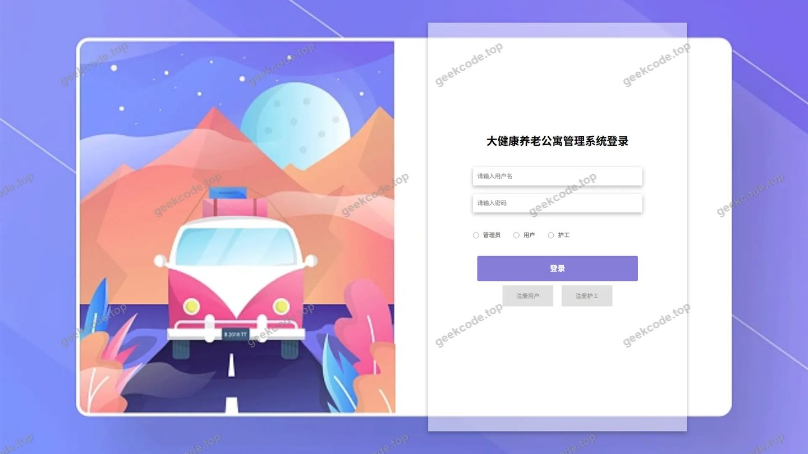</a>

<h4>后台-公告信息</h4>

<a href="https://geekcode.top/archives/%E5%A4%A7%E5%81%A5%E5%BA%B7%E5%85%BB%E8%80%81%E5%85%AC%E5%AF%93%E7%AE%A1%E7%90%86%E7%B3%BB%E7%BB%9Fto14d?utm_source=github" title="查看完整源码">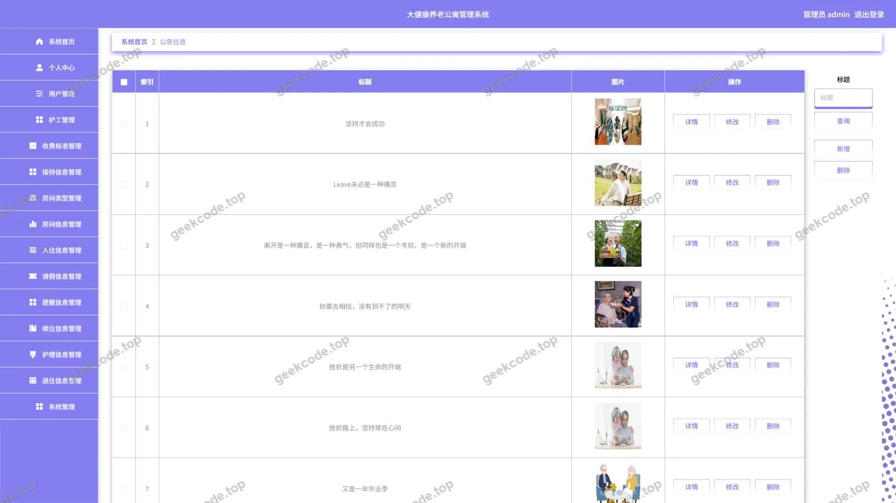</a>

<h4>后台-请假信息</h4>

<a href="https://geekcode.top/archives/%E5%A4%A7%E5%81%A5%E5%BA%B7%E5%85%BB%E8%80%81%E5%85%AC%E5%AF%93%E7%AE%A1%E7%90%86%E7%B3%BB%E7%BB%9Fto14d?utm_source=github" title="查看完整源码">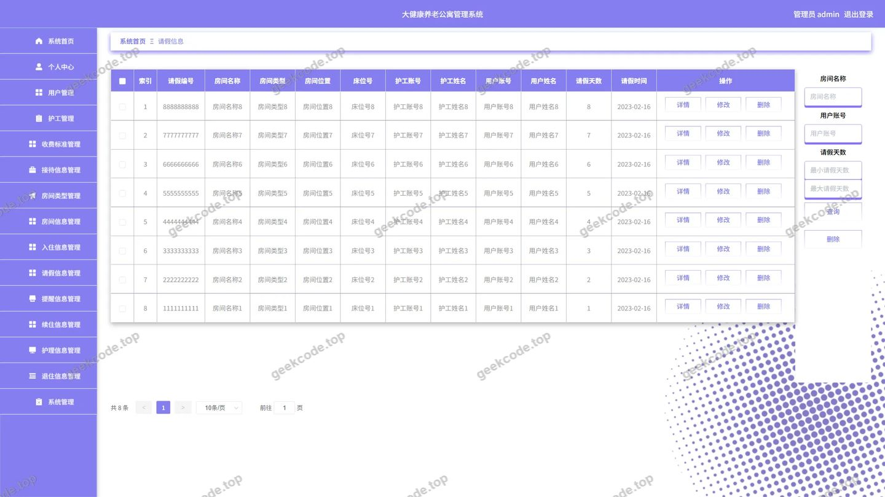</a>

<h4>后台-入住信息</h4>

<a href="https://geekcode.top/archives/%E5%A4%A7%E5%81%A5%E5%BA%B7%E5%85%BB%E8%80%81%E5%85%AC%E5%AF%93%E7%AE%A1%E7%90%86%E7%B3%BB%E7%BB%9Fto14d?utm_source=github" title="查看完整源码">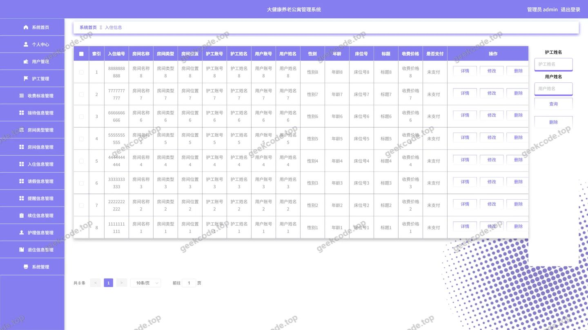</a>

<h4>后台-收费标准</h4>

<h4>后台-提醒信息</h4>

<a href="https://geekcode.top/archives/%E5%A4%A7%E5%81%A5%E5%BA%B7%E5%85%BB%E8%80%81%E5%85%AC%E5%AF%93%E7%AE%A1%E7%90%86%E7%B3%BB%E7%BB%9Fto14d?utm_source=github" title="查看完整源码">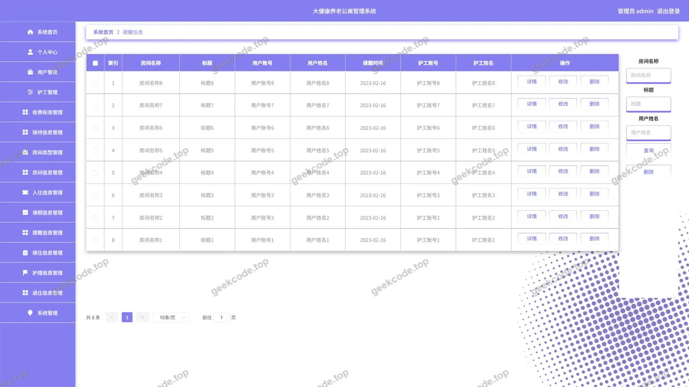</a>

<h4>后台-退住信息</h4>

<a href="https://geekcode.top/archives/%E5%A4%A7%E5%81%A5%E5%BA%B7%E5%85%BB%E8%80%81%E5%85%AC%E5%AF%93%E7%AE%A1%E7%90%86%E7%B3%BB%E7%BB%9Fto14d?utm_source=github" title="查看完整源码">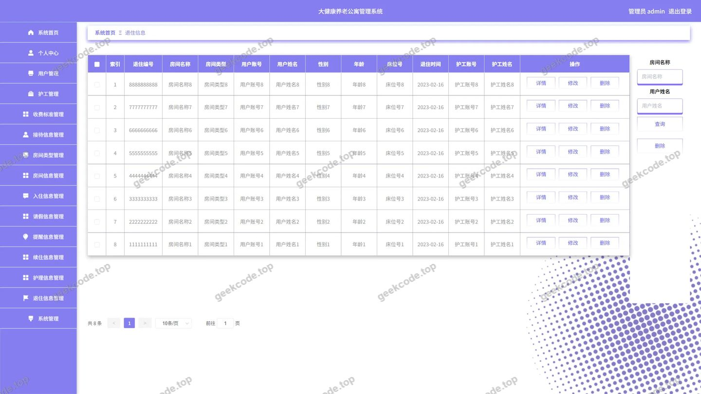</a>

<h4>后台-续住信息</h4>

<a href="https://geekcode.top/archives/%E5%A4%A7%E5%81%A5%E5%BA%B7%E5%85%BB%E8%80%81%E5%85%AC%E5%AF%93%E7%AE%A1%E7%90%86%E7%B3%BB%E7%BB%9Fto14d?utm_source=github" title="查看完整源码">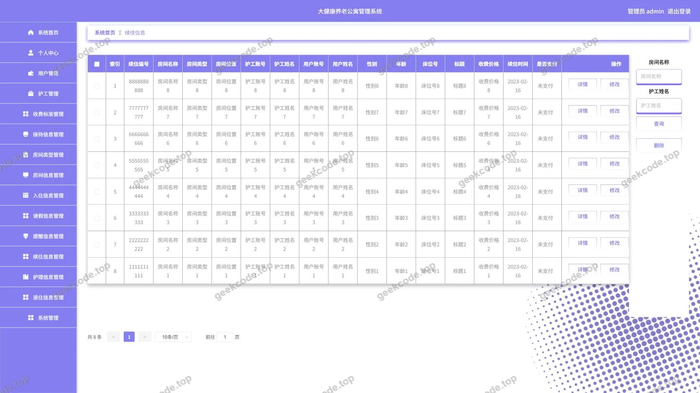</a>

---

## 获取完整源码

| 项目 | 说明 |
| --- | --- |
| 项目名 | 大健康养老公寓管理系统to14d |
| 运行截图 | 本文 15 张（站点带水印原图，仓库 `images/` 目录） |
| 完整源码 | [https://geekcode.top/archives/%E5%A4%A7%E5%81%A5%E5%BA%B7%E5%85%BB%E8%80%81%E5%85%AC%E5%AF%93%E7%AE%A1%E7%90%86%E7%B3%BB%E7%BB%9Fto14d?utm_source=github](https://geekcode.top/archives/%E5%A4%A7%E5%81%A5%E5%BA%B7%E5%85%BB%E8%80%81%E5%85%AC%E5%AF%93%E7%AE%A1%E7%90%86%E7%B3%BB%E7%BB%9Fto14d?utm_source=github) |
| 咨询微信 | **ir9372**（备注：jingpin-yuanma） |
| 更多项目 | [极客代码 geekcode.top](https://geekcode.top/?utm_source=github) |

> 需要源码、部署、改配置、跑不起来等问题，加微信 ir9372 沟通，说明项目名即可。
